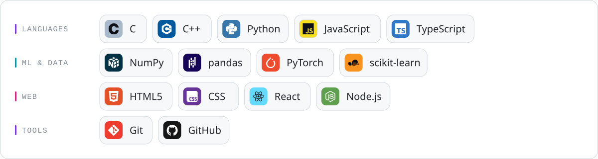
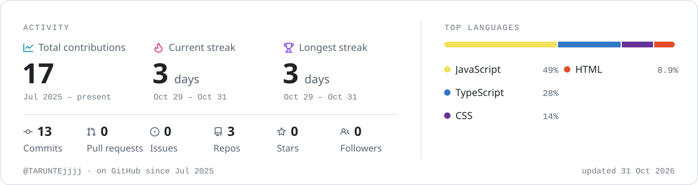

<!--
  The images below are generated: edit profile.json (banner text, tech stack) and the
  "Build profile" workflow redraws them. `python3 scripts/build.py` redraws the banner and
  stack locally; only the workflow draws the activity card, because its token sees public
  data only.
-->

<picture>
  <source media="(prefers-color-scheme: dark)" srcset="assets/header-dark.svg">
  
</picture>

## About me

I'm Tarun Tej, learning **AI, algorithms and mathematics** through implementation, experiments and problem solving. I work mainly with Python and C++, and build browser tools that make technical ideas easier to explore.

- **Machine learning:** understanding model behaviour, numerical methods and reproducible experiments.
- **Algorithms and maths:** practising problem solving, correctness arguments and complexity analysis.
- **Systems:** exploring exact arithmetic, persistent storage and the tradeoffs behind small implementations.

## Selected projects

| Project | What it explores | Explore the work |
| --- | --- | --- |
| **[AxiomMath](https://github.com/TARUNTEjjjj/axiom-math)** | Exact rational arithmetic and expression parsing in C++20, with explicit overflow bounds and differential checks against Python's `fractions.Fraction`. | [Design and arithmetic reasoning](https://github.com/TARUNTEjjjj/axiom-math/blob/main/docs/engineering.md) · [Verification](https://github.com/TARUNTEjjjj/axiom-math/blob/main/docs/verification.md) |
| **[PocketKV](https://github.com/TARUNTEjjjj/pocketkv)** | A persistent C++20 key-value store exploring append-only logs, indexing, checksums, file locking and recovery. | [Storage design](https://github.com/TARUNTEjjjj/pocketkv/blob/main/docs/engineering.md) · [Reproducible benchmark and results](https://github.com/TARUNTEjjjj/pocketkv/blob/main/docs/benchmarks.md) |
| **[Axiom SAT Math](https://github.com/TARUNTEjjjj/axiom-sat)** | Browser-based maths practice with reproducible question generation, worked solutions and recoverable local progress. | [Try the app](https://axiom-sat.pages.dev/) · [Design notes](https://github.com/TARUNTEjjjj/axiom-sat/blob/main/docs/engineering.md) |
| **Forge** | Interactive Python, Git and algorithms learning with browser-based exercises, built with React and TypeScript. | [Try the learning map](https://forge-learning-academy.pages.dev/) |

For a quick technical tour, start with AxiomMath's arithmetic bounds or PocketKV's recovery model. The linked notes explain assumptions, tests and limitations alongside the code.

## Tech stack

<picture>
  <source media="(prefers-color-scheme: dark)" srcset="assets/stack-dark.svg">
  
</picture>

## GitHub activity

<picture>
  <source media="(prefers-color-scheme: dark)" srcset="assets/activity-dark.svg">
  
</picture>

<picture>
  <source media="(prefers-color-scheme: dark)" srcset="assets/snake-dark.svg">
  
</picture>

<!--
## Connect
Uncomment and fill in to add contact badges:

-->

Cards drawn by <a href="scripts/build.py">scripts/build.py</a> and refreshed daily by GitHub Actions · logos via <a href="https://simpleicons.org">Simple Icons</a>; HTML5 logo by W3C and Git logo by Jason Long, <a href="https://creativecommons.org/licenses/by/3.0/">CC BY 3.0</a> · <a href="THIRD_PARTY_NOTICES.md">all credits</a>

