<!--
  The images below are generated: edit profile.json (banner text, tech stack) and the
  "Build profile" workflow redraws them. `python3 scripts/build.py` redraws the banner and
  stack locally. The activity card is not shown here, so the workflow no longer draws it;
  scripts/build.py explains how to preview it or bring it back.
-->

<picture>
  <source media="(prefers-color-scheme: dark)" srcset="assets/header-dark.svg">
  
</picture>

## About me

**Python & C++20 Systems Engineer · 3D WebGL2 Builder · AI Code Evaluator**

I'm Tarun Tej. I build **interactive 3D WebGL2 simulations and scientific tools** (React, TypeScript, GLSL shaders, Canvas2D fallbacks), **memory-safe C++20 and SwiftUI native applications**, and **first-principles NumPy/PyTorch neural networks** backed by property-based fuzzing, differential oracles, and accessibility testing.

At Outlier and Mercor, I perform **Side-by-Side (SxS) model evaluations, AI code reviews, and adversarial prompt engineering** to test reasoning depth, instruction adherence, and code correctness for frontier LLMs. I am looking for opportunities in **Python / AI/ML engineering, C++20 / systems tooling, interactive 3D web engineering, and AI code evaluation**.

[Visit my 3D portfolio](https://tarun-tej.pages.dev/) · [Browse my repositories](https://github.com/TARUNTEjjjj?tab=repositories)

## Featured projects

### StormSignal · 3D atmospheric Earth & weather with evidence

A weather workspace that pairs an interactive WebGL 2 3D globe and custom atmospheric shaders with multi-agency forecasts, model disagreement, and official warning coverage, never treating missing data as an all-clear.

**React 19 · TypeScript · three.js / WebGL 2 · Custom GLSL · Cloudflare Pages Worker · NASA GIBS**

- **Interactive 3D globe & atmosphere:** NASA's finished daily satellite mosaic rendered with sun-position day/night lighting, Fresnel atmospheric rim & volumetric cloud shaders, live official warning overlays, and full keyboard orbit controls.
- **Official warnings with honest limits:** Integrates NWS, PAGASA, BMKG, IMD, India's SACHET feeds, and participating WMO authorities via a Cloudflare Worker gateway; unreachable sources stay clearly marked unavailable.
- **Resilient across connections:** Data saver mode (zero 3D or background polling), Full workspace (3D globe, maps, and reports), and Offline only mode (dated briefings and self-contained field kit).
- **Engineering record:** Automated React/three.js scene suites, differential GLSL shader testing, WCAG AA accessibility verification (pausable motion, visible focus, keyboard-only controls), and published verification records.

[Try StormSignal](https://stormsignal-weather.pages.dev/) · [Read the source](https://github.com/TARUNTEjjjj/stormsignal) · [UI case study](https://github.com/TARUNTEjjjj/stormsignal/blob/main/docs/ui-case-study.md) · [Verification record](https://github.com/TARUNTEjjjj/stormsignal/blob/main/docs/verification.md)

### Neural Math Lab · 3D manifold studio & neural networks from first principles

Understand neural network mechanics from exact tensor equations rather than opaque abstractions — featuring an interactive **WebGL2 3D Manifold Studio** (3D loss landscapes, decision surfaces, and 3D computation graphs) plus a Canvas2D software projection fallback.

**Python · NumPy · PyTorch · WebGL2 / GLSL · Optimization (SGD & Adam) · Cloudflare Pages**

- **First-principles mathematics:** Explicit forward/backward passes for Sigmoid, Tanh, and ReLU activations, numerical finite-difference gradient/Hessian checks, and saturation stability analysis.
- **Interactive 3D surface explorer:** Drag/keyboard 3D camera orbit, surface parameter morphing, and GPU-accelerated Phong lighting for XOR, Moons, Circles, and Iris experiments.
- **Zero-dependency portability:** Self-contained offline HTML/SVG experiment reports and checkpoint replay without runtime server requirements.

[Try Neural Math Lab](https://neural-math-lab.pages.dev/) · [Read the source](https://github.com/TARUNTEjjjj/neural-math-lab)

## More of what I'm building

### Interactive 3D web platforms

| Area | Project | Highlights |
| --- | --- | --- |
| **Mathematics & geometry** | [Axiom SAT Math](https://github.com/TARUNTEjjjj/axiom-sat) · [Live app](https://axiom-sat.pages.dev/) | WebGL2 3D Geometry Studio (conic sections, solids, vector fields), 31 seeded templates, offline storage, and cross-browser Playwright/Axe verification. |
| **AI learning interfaces** | [Attention Atlas](https://github.com/TARUNTEjjjj/attention-atlas) · [Live guide](https://attention-atlas.pages.dev/) | Interactive 3D WebGL2 tensor & self-attention manifold explorer alongside live CNN, RNN, and Transformer matrix explanations. |
| **Differential geometry & WebAssembly** | [Avenquellis](https://github.com/TARUNTEjjjj/avenquellis-web) | WebGL2 PBR/Fresnel 3D minimal surfaces & geodesic tracer (Torus, Möbius, Saddle, Enneper) paired with C++/WebAssembly exact verification and offline Service Worker. |
| **Timed JEE physics & math** | [Vedaris JEE](https://github.com/TARUNTEjjjj/vedaris-jee) · [Live workspace](https://vedaris-jee.pages.dev/) | Interactive WebGL2 3D physics/chemistry/math visualizers (PCM3D), historical papers, WCAG AA focus/keyboard support, and offline local progress. |
| **Coding curriculum (Web)** | [Forge Learning Academy](https://github.com/TARUNTEjjjj/forge-learning-academy) | Interactive 3D WebGL2 learning archipelago + in-browser Python, C++, Git, and algorithms labs with reduced-motion fallback. |
| **Portfolio** | [tarun-tej-portfolio](https://github.com/TARUNTEjjjj/tarun-tej-portfolio) · [Live site](https://tarun-tej.pages.dev/) | Custom sub-100 KB WebGL2 3D interactive developer portfolio engineered for instant first load and accessible motion. |

### Native C++20, SwiftUI & verification tools

| Domain | Project | Highlights |
| --- | --- | --- |
| **Systems storage (C++20)** | [PocketKV](https://github.com/TARUNTEjjjj/pocketkv) | Append-only KV store with CRC32 checksums, file locking, atomic snapshots, `--json` CLI output, `inspect` space-amplification forensics, and bitflip/truncation fuzz tests. |
| **Exact arithmetic (C++20)** | [AxiomMath](https://github.com/TARUNTEjjjj/axiom-math) | Exact 64/128-bit rational & expression engine with `cf` continued-fraction convergents, `--json` repeating-decimal/IEEE-754 deltas, and Farey/parser fuzzing vs Python `Fraction`. |
| **Question synthesis (C++20 & JS)** | [Avenquellis Question Engine](https://github.com/TARUNTEjjjj/avenquellis-question-engine) | Deterministic math problem engine with `analyze` / `analyze-bank` Shannon topic entropy telemetry and statistical/Unicode C++↔JS differential fuzzing. |
| **Proof verification (C++20 & WASM)** | [Avenquellis Proof Grader](https://github.com/TARUNTEjjjj/avenquellis-proof-grader) | Bounded proof-certificate checker with `diagnose` dependency-DAG soundness analysis, `--pretty` output, and adversarial Bézout/Wilson/QWK calibration fuzzing. |
| **Native desktop (SwiftUI)** | [Forge for Mac](https://github.com/TARUNTEjjjj/forge-macos) | Native macOS SwiftUI workspace with animated 3D orbital chapter prisms, interactive card tilt, `--diagnostics` JSON CLI, and property-based journal/search oracle checks. |

## Tech stack

<picture>
  <source media="(prefers-color-scheme: dark)" srcset="assets/stack-dark.svg">
  
</picture>

## GitHub activity

For reviewable work, start with [StormSignal's commits](https://github.com/TARUNTEjjjj/stormsignal/commits/main/) and [pull requests](https://github.com/TARUNTEjjjj/stormsignal/pulls?q=is%3Apr). The contribution graph records activity; code, explanations and verification provide the context behind it.

<picture>
  <source media="(prefers-color-scheme: dark)" srcset="assets/snake-dark.svg">
  
</picture>

Cards drawn by <a href="scripts/build.py">scripts/build.py</a> and refreshed daily by GitHub Actions · most logos via <a href="https://simpleicons.org">Simple Icons</a> (C++, Python and pandas: their owners' official logos); HTML5 logo by W3C and Git logo by Jason Long, <a href="https://creativecommons.org/licenses/by/3.0/">CC BY 3.0</a> · <a href="THIRD_PARTY_NOTICES.md">all credits</a>

Preview and validate profile cards locally

Run `python3 scripts/build.py --check` to render and validate the banner and
stack without changing files. Use `--output-dir /path/to/preview` for a separate
preview directory, and `--data scripts/sample-stats.json` to include activity
cards without network access; that sample shows the snapshot format. A `--data`
preview goes to `preview/`, which git ignores, unless `--output-dir` names
another directory, and never into `assets/`. `--today YYYY-MM-DD` chooses the
day, by default the snapshot's last one. The chosen day bounds contribution
calendar totals and streaks; other aggregate counts retain the snapshot values.
All cards are rendered and checked as SVG before any are written, and individual
files are replaced atomically. `python3 -m unittest discover -s tests -v` exercises
these offline paths; pull requests run the same checks without a write token.

## GitHub resource collection

Explore the project-specific [resource catalog](resources/README.md): curated references, star-ranked discovery, dated source metadata, cached failure recovery and an optional read-only server API. The repository includes a daily refresh workflow; hosted sites still follow their existing deployment process.
