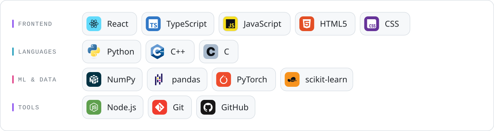

<!--
  The images below are generated: edit profile.json (banner text, tech stack) and the
  "Build profile" workflow redraws them. `python3 scripts/build.py` redraws the banner and
  stack locally; only the workflow draws the activity card, because its token sees public
  data only.
-->

<picture>
  <source media="(prefers-color-scheme: dark)" srcset="assets/header-dark.svg">
  
</picture>

## About me

**Web Developer · AI/ML Enthusiast · AI Code Evaluator**

I'm Tarun Tej. I build web applications with **React, TypeScript and JavaScript**, and explore **machine learning, mathematics and systems** through Python and C++ projects. My work includes weather-data interfaces, reproducible neural-network experiments, exact arithmetic and learning tools.

I'm interested in **web development, software engineering, AI evaluation and entry-level AI/ML opportunities**. I care about readable interfaces, reliable behavior, reproducible tests and explaining the limits of a result.

[Visit my portfolio](https://tarun-tej.pages.dev/) · [Browse my repositories](https://github.com/TARUNTEjjjj?tab=repositories)

## What I'm building

| Area | Project | Work to explore |
| --- | --- | --- |
| **AI/ML foundations** | [Neural Math Lab](https://github.com/TARUNTEjjjj/neural-math-lab) · [Live experiments](https://neural-math-lab.pages.dev/) | Forward propagation, backpropagation, SGD and Adam implemented in NumPy; reproducible experiments, gradient checks and held-out evaluation. |
| **AI learning interfaces** | [Attention Atlas](https://github.com/TARUNTEjjjj/attention-atlas) · [Live guide](https://attention-atlas.pages.dev/) | Interactive CNN, RNN and Transformer mathematics with editable inputs, matrix calculations and explanations. |
| **Systems programming** | [PocketKV](https://github.com/TARUNTEjjjj/pocketkv) | A persistent C++20 key-value store with an append-only log, checksums, file locking, snapshots and recovery. |
| **Mathematics and C++** | [AxiomMath](https://github.com/TARUNTEjjjj/axiom-math) | Exact rational arithmetic and expression parsing with explicit overflow bounds and differential checks against Python's `fractions.Fraction`. |
| **Web and assessment tools** | [Avenquellis](https://github.com/TARUNTEjjjj/avenquellis-web) · [Question engine](https://github.com/TARUNTEjjjj/avenquellis-question-engine) · [Proof grader](https://github.com/TARUNTEjjjj/avenquellis-proof-grader) | A mathematics workspace using C++/WebAssembly, reproducible questions and bounded proof-certificate checks. Free-form model assessments remain proposals for human review. |
| **Learning applications** | [Vedaris JEE](https://github.com/TARUNTEjjjj/vedaris-jee) · [Live workspace](https://vedaris-jee.pages.dev/) | Timed practice, historical-paper sessions, worked review, validated content and recoverable browser-local progress. |

Other work: [Axiom SAT Math](https://github.com/TARUNTEjjjj/axiom-sat) for generated maths practice; [Forge](https://github.com/TARUNTEjjjj/forge-learning-academy) for browser-based Python and Git exercises; and [Forge for Mac](https://github.com/TARUNTEjjjj/forge-macos), a native SwiftUI study workspace.

## Featured project · StormSignal

**React · TypeScript · SVG · Responsive UI · Offline workflows**

Explore a forecast by metric, time range and individual hour; inspect the exact values behind the graph; and switch between Data saver, Full workspace and Offline only. The interface distinguishes current forecasts, official warnings, missing sources and historical copies.

[Try StormSignal](https://stormsignal-weather.pages.dev/) · [Read the source](https://github.com/TARUNTEjjjj/stormsignal) · [UI case study](https://github.com/TARUNTEjjjj/stormsignal/blob/main/docs/ui-case-study.md) · [Verification record](https://github.com/TARUNTEjjjj/stormsignal/blob/main/docs/verification.md) · [Change history](https://github.com/TARUNTEjjjj/stormsignal/commits/main/)

The case study includes expected behavior and reproducible review steps. Dated verification notes distinguish observed results from untested limits.

## Tech stack

<picture>
  <source media="(prefers-color-scheme: dark)" srcset="assets/stack-dark.svg">
  
</picture>

## GitHub activity

For reviewable work, start with [StormSignal's commits](https://github.com/TARUNTEjjjj/stormsignal/commits/main/) and [pull requests](https://github.com/TARUNTEjjjj/stormsignal/pulls?q=is%3Apr). The contribution graph records activity; code, explanations and verification provide the context behind it.

<picture>
  <source media="(prefers-color-scheme: dark)" srcset="assets/snake-dark.svg">
  
</picture>

Cards drawn by <a href="scripts/build.py">scripts/build.py</a> and refreshed daily by GitHub Actions · most logos via <a href="https://simpleicons.org">Simple Icons</a> (C++, Python and pandas: their owners' official logos); HTML5 logo by W3C and Git logo by Jason Long, <a href="https://creativecommons.org/licenses/by/3.0/">CC BY 3.0</a> · <a href="THIRD_PARTY_NOTICES.md">all credits</a>

Preview and validate profile cards locally

Run `python3 scripts/build.py --check` to render and validate the banner and
stack without changing files. Use `--output-dir /path/to/preview` for a separate
preview directory, and `--data snapshot.json --today YYYY-MM-DD` to include
activity cards without network access. The chosen day bounds contribution
calendar totals and streaks; other aggregate counts retain the snapshot values.
All cards are rendered and checked as SVG before any are written, and individual
files are replaced atomically. `python3 -m unittest discover -s tests -v` exercises
these offline paths; pull requests run the same checks without a write token.

## GitHub resource collection

Explore the project-specific [resource catalog](resources/README.md): curated references, star-ranked discovery, dated source metadata, cached failure recovery and an optional read-only server API. The repository includes a daily refresh workflow; hosted sites still follow their existing deployment process.
