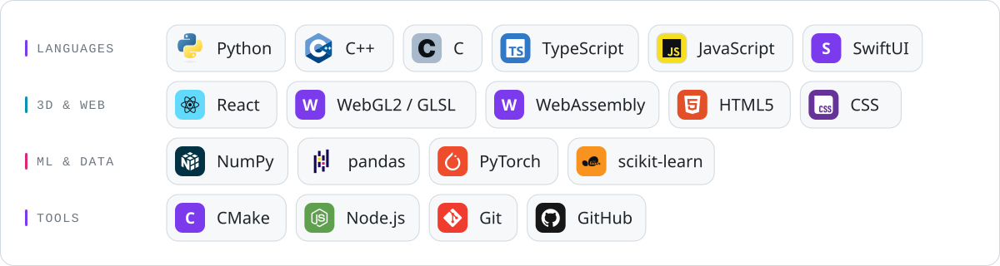

<!--
  The images below are generated: edit profile.json (banner text, tech stack) and the
  "Build profile" workflow redraws them. `python3 scripts/build.py` redraws the banner and
  stack locally. The activity card is not shown here, so the workflow no longer draws it;
  scripts/build.py explains how to preview it or bring it back.
-->

<picture>
  <source media="(prefers-color-scheme: dark)" srcset="assets/header-dark.svg">
  
</picture>

## About me

**Web Developer · AI/ML Enthusiast · AI Code Evaluator**

I'm Tarun Tej. I build web applications with **React, TypeScript and JavaScript**, and explore **machine learning, mathematics and systems** through Python and C++ projects. My work includes a weather-evidence dashboard with an interactive 3D globe, reproducible neural-network experiments, exact arithmetic and learning tools.

I'm interested in **web development, software engineering, AI evaluation and entry-level AI/ML opportunities**. I care about readable interfaces, reliable behavior, reproducible tests and explaining the limits of a result.

[Visit my portfolio](https://tarun-tej.pages.dev/) · [Browse my repositories](https://github.com/TARUNTEjjjj?tab=repositories)

## Featured projects

### StormSignal · weather with evidence

A weather workspace that puts forecasts, satellite imagery, model disagreement and official warning coverage in one view, and never treats missing data as an all-clear.

**React 19 · TypeScript · three.js / WebGL 2 · Cloudflare Pages Worker · Leaflet · NASA GIBS**

- **Interactive 3D globe:** NASA's newest finished daily satellite mosaic, with its date and coverage stated, day and night drawn from the sun's position, and active official warning outlines. It works fully by keyboard, and three.js loads only in Full workspace on browsers with WebGL 2.
- **Official warnings with their limits shown:** the US National Weather Service, read straight from the browser, plus PAGASA (Philippines), BMKG (Indonesia), IMD's Kolkata district nowcast, India's regional SACHET feeds and participating WMO authorities through the project's own Cloudflare Worker gateway. An unreachable source is reported as unavailable.
- **Three modes for weak connections:** Data saver (default; no 3D or background polling), Full workspace (globe, maps and reports) and Offline only (dated saved briefings and a self-contained field kit).
- **Interactive forecast explorer:** inspect any hour by pointer or keyboard, read the exact values, compare two models and export CSV.
- **Engineering record:** 708 application tests, including scene tests on real three.js and a test-only GLSL interpreter that runs the globe's surface shader on the CPU; accessibility tests tied to specific WCAG criteria (contrast, visible focus, pausable motion, controls that need no drag); and a dated verification record that states what was and was not tested.

[Try StormSignal](https://stormsignal-weather.pages.dev/) · [Read the source](https://github.com/TARUNTEjjjj/stormsignal) · [UI case study](https://github.com/TARUNTEjjjj/stormsignal/blob/main/docs/ui-case-study.md) · [Verification record](https://github.com/TARUNTEjjjj/stormsignal/blob/main/docs/verification.md)

### Axiom SAT Math · reproducible math practice

Free SAT-style math practice with original generated questions, timed sessions and worked review. There is no account, backend or runtime dependency: progress stays in the browser.

**HTML · CSS · JavaScript ES modules · Playwright · axe-core · Cloudflare Pages**

- **Reproducible questions:** 31 seeded templates across the four SAT Math domains. A template ID and a seed recreate the exact question, so any question can be shared as a link.
- **Practice modes:** a 10-question 16-minute sprint, a 22-question 35-minute module or a custom set of 5, 10 or 20 questions. Sessions survive a reload, and a timed session keeps counting while the page is closed.
- **Honest progress:** first-attempt accuracy by domain, retries of exactly the missed and skipped questions, and backups that are validated and regraded on import rather than trusted.
- **Checked on every push and pull request:** every template is audited over 5,004 seeds; seeds 0–199 of every template (6,200 questions) are fingerprinted, so CI fails if a change alters one without a documented re-baseline; and Playwright drives Chromium, Firefox and WebKit through learner journeys, keyboard-only use and storage failures, with axe-core's WCAG 2.2 A/AA rules on every page.

[Try Axiom SAT](https://axiom-sat.pages.dev/) · [Read the source](https://github.com/TARUNTEjjjj/axiom-sat) · [Verification record](https://github.com/TARUNTEjjjj/axiom-sat/blob/main/docs/verification.md)

Axiom is independent practice, not an official SAT test, and is not affiliated with or endorsed by College Board.

## More of what I'm building

| Area | Project | Work to explore |
| --- | --- | --- |
| **AI/ML foundations** | [Neural Math Lab](https://github.com/TARUNTEjjjj/neural-math-lab) · [Live experiments](https://neural-math-lab.pages.dev/) | Forward propagation, backpropagation, SGD and Adam implemented in NumPy; reproducible experiments, gradient checks and held-out evaluation. |
| **AI learning interfaces** | [Attention Atlas](https://github.com/TARUNTEjjjj/attention-atlas) · [Live guide](https://attention-atlas.pages.dev/) | Interactive CNN, RNN and Transformer mathematics with editable inputs, matrix calculations and explanations. |
| **Systems programming** | [PocketKV](https://github.com/TARUNTEjjjj/pocketkv) | A persistent C++20 key-value store with an append-only log, checksums, file locking, snapshots and recovery. |
| **Mathematics and C++** | [AxiomMath](https://github.com/TARUNTEjjjj/axiom-math) | Exact rational arithmetic and expression parsing with explicit overflow bounds and differential checks against Python's `fractions.Fraction`. |
| **Web and assessment tools** | [Avenquellis](https://github.com/TARUNTEjjjj/avenquellis-web) · [Question engine](https://github.com/TARUNTEjjjj/avenquellis-question-engine) · [Proof grader](https://github.com/TARUNTEjjjj/avenquellis-proof-grader) | A mathematics workspace using C++/WebAssembly, reproducible questions and bounded proof-certificate checks. Free-form model assessments remain proposals for human review. |
| **Learning applications** | [Vedaris JEE](https://github.com/TARUNTEjjjj/vedaris-jee) · [Live workspace](https://vedaris-jee.pages.dev/) | Timed practice, historical-paper sessions, worked review, validated content and recoverable browser-local progress. |

Other work: [Forge](https://github.com/TARUNTEjjjj/forge-learning-academy) for browser-based Python and Git exercises; and [Forge for Mac](https://github.com/TARUNTEjjjj/forge-macos), a native SwiftUI study workspace.

## Tech stack

<picture>
  <source media="(prefers-color-scheme: dark)" srcset="assets/stack-dark.svg">
  
</picture>

## GitHub activity

For reviewable work, start with [StormSignal's commits](https://github.com/TARUNTEjjjj/stormsignal/commits/main/) and [pull requests](https://github.com/TARUNTEjjjj/stormsignal/pulls?q=is%3Apr). The contribution graph records activity; code, explanations and verification provide the context behind it.

<picture>
  <source media="(prefers-color-scheme: dark)" srcset="assets/snake-dark.svg">
  
</picture>

Cards drawn by <a href="scripts/build.py">scripts/build.py</a> and refreshed daily by GitHub Actions · most logos via <a href="https://simpleicons.org">Simple Icons</a> (C++, Python and pandas: their owners' official logos); HTML5 logo by W3C and Git logo by Jason Long, <a href="https://creativecommons.org/licenses/by/3.0/">CC BY 3.0</a> · <a href="THIRD_PARTY_NOTICES.md">all credits</a>

Preview and validate profile cards locally

Run `python3 scripts/build.py --check` to render and validate the banner and
stack without changing files. Use `--output-dir /path/to/preview` for a separate
preview directory, and `--data scripts/sample-stats.json` to include activity
cards without network access; that sample shows the snapshot format. A `--data`
preview goes to `preview/`, which git ignores, unless `--output-dir` names
another directory, and never into `assets/`. `--today YYYY-MM-DD` chooses the
day, by default the snapshot's last one. The chosen day bounds contribution
calendar totals and streaks; other aggregate counts retain the snapshot values.
All cards are rendered and checked as SVG before any are written, and individual
files are replaced atomically. `python3 -m unittest discover -s tests -v` exercises
these offline paths; pull requests run the same checks without a write token.

## GitHub resource collection

Explore the project-specific [resource catalog](resources/README.md): curated references, star-ranked discovery, dated source metadata, cached failure recovery and an optional read-only server API. The repository includes a daily refresh workflow; hosted sites still follow their existing deployment process.
